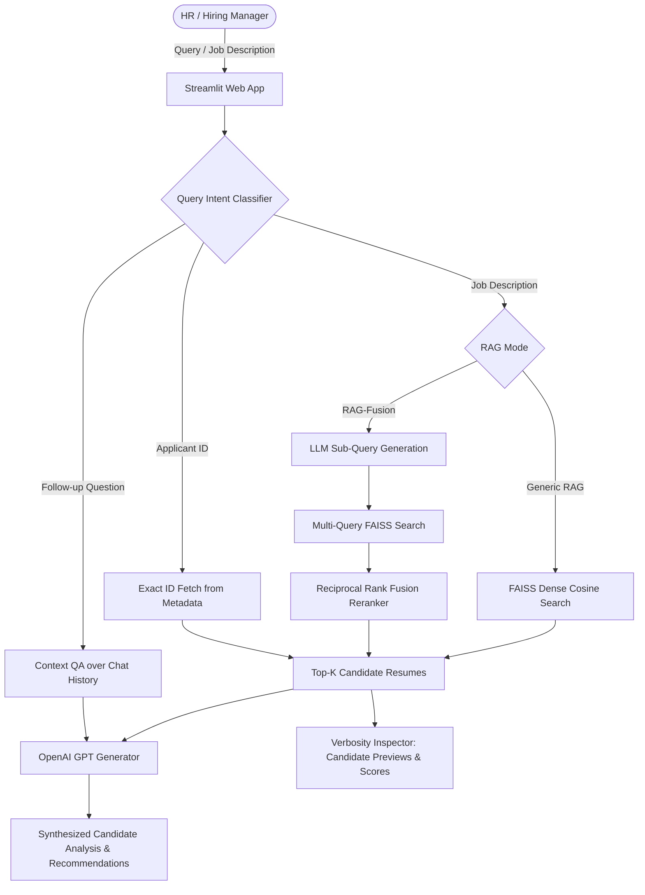

# 📄 Resume Screening RAG Pipeline

[](https://www.python.org/)
[](https://www.langchain.com/)
[](https://streamlit.io/)
[](https://github.com/facebookresearch/faiss)
[](https://openai.com/)
[](LICENSE)

An intelligent, end-to-end **Retrieval-Augmented Generation (RAG)** pipeline designed to empower recruiters and hiring managers in screening, ranking, and analyzing resumes against complex job descriptions with high precision, speed, and explainability.

---

## 📌 Table of Contents

- [Overview](#-overview)
- [Architecture & Workflow](#-architecture--workflow)
- [Key Features](#-key-features)
- [Repository Structure](#-repository-structure)
- [Installation & Quickstart](#-installation--quickstart)
- [How It Works](#-how-it-works)
  - [1. Query Intent Routing](#1-query-intent-routing)
  - [2. Dual RAG Retrieval Strategies](#2-dual-rag-retrieval-strategies)
  - [3. Interactive UI & Verbosity Inspection](#3-interactive-ui--verbosity-inspection)
- [Data Ingestion & PDF Processing](#-data-ingestion--pdf-processing)
- [Evaluation & Benchmarking (RAGAS)](#-evaluation--benchmarking-ragas)
- [Tech Stack](#-tech-stack)
- [License](#-license)

---

## 🔍 Overview

Screening thousands of applicants manually or relying on rudimentary keyword matching leads to high false-negative rates, overlooked talent, and biased evaluations. 

This project solves this bottleneck by implementing a **hybrid RAG architecture** combining:
- **Semantic Vector Search (FAISS)** powered by `sentence-transformers/all-MiniLM-L6-v2`.
- **RAG-Fusion with Reciprocal Rank Fusion (RRF)** for multi-faceted candidate evaluation.
- **Dynamic Query Routing** to automatically distinguish between job descriptions, applicant ID lookups, and conversational follow-up questions.
- **Interactive Recruiter Dashboard** built in Streamlit with inspectable retrieval steps, candidate popover previews, and custom dataset ingestion.

---

## 🏗️ Architecture & Workflow



---

## ✨ Key Features

- **Dual Retrieval Modes**:
  - **Generic RAG**: Direct dense semantic retrieval using FAISS and cosine distance.
  - **RAG-Fusion**: Deconstructs detailed job postings into 3–4 targeted sub-aspects (e.g., technical stack, domain leadership, experience level), retrieves candidate subsets for each aspect, and reranks them via **Reciprocal Rank Fusion (RRF)**.
- **Intelligent Query Intent Routing**:
  - `retrieve_applicant_jd`: Detected job description triggers full semantic retrieval and matching.
  - `retrieve_applicant_id`: Detected candidate ID bypasses vector search and performs targeted analysis on specified applicant(s).
  - `no_retrieve`: Natural language follow-up queries leverage conversational context without unnecessary vector re-queries.
- **Custom Data Ingestion**:
  - Pre-indexed FAISS vector stores for synthetic resumes and real-world parsed PDF resumes.
  - On-the-fly CSV resume upload with real-time text chunking (`RecursiveCharacterTextSplitter`) and in-memory FAISS indexing.
  - Offline batch PDF parsing pipeline (`demo/interactive/convert_pdf.py`) utilizing `pypdf`.
- **Transparent Verbosity Panel**:
  - Full observability into latency, detected query intent, generated sub-queries, reranking scores, and individual candidate resume popover previews.
- **RAGAS Benchmark Suite**:
  - Quantitative evaluation notebooks assessing Answer Semantic Similarity, Faithfulness, Context Precision, and Context Recall.

---

## 📁 Repository Structure

```text
.
├── demo/
│   ├── interface.py              # Streamlit web application & control panel
│   ├── llm_agent.py              # LangChain chat agent & sub-query generator
│   ├── retriever.py              # SelfQueryRetriever & Reciprocal Rank Fusion logic
│   ├── ingest_data.py            # Text chunking & FAISS index builder
│   ├── chatbot_verbosity.py      # Streamlit expander for retrieval explainability
│   └── interactive/
│       ├── convert_pdf.py        # PDF batch text extraction script
│       └── ingest_data.py        # Interactive indexing script
├── data/
│   ├── main-data/                # Synthetic resumes, test sets, and checkpoint files
│   └── supplementary-data/       # PDF resumes, cleaned CSVs, and job description samples
├── evaluation/
│   ├── ragas_evaluation.ipynb    # RAGAS framework metrics evaluation
│   ├── metrics_computation.ipynb # Comparative metrics analysis
│   ├── testset_generation.ipynb  # Ground-truth test set synthesis
│   ├── results_generation.ipynb  # Inference generation for benchmark sets
│   └── images/                   # Metric visualization assets (AS, FA, CP, CR)
├── preprocessing/
│   ├── data_cleaning.ipynb       # Resume & job description cleaning workflows
│   └── data_ingestion.ipynb      # Raw data ingestion pipeline
├── vectorstore/                  # Default pre-built FAISS vector store
├── vectorstore-pdf/              # Pre-built FAISS vector store for PDF resumes
├── vectorstore-synthetic/        # Pre-built FAISS vector store for synthetic dataset
├── requirements.txt              # Project dependencies
├── .env.example                  # Environment configuration template
└── README.md                     # Project documentation
```

---

## 🚀 Installation & Quickstart

### 1. Prerequisites
- Python 3.10 or higher
- An [OpenAI API Key](https://platform.openai.com/)

### 2. Clone the Repository
```bash
git clone https://github.com/<your-username>/Resume-Screening-RAG-Pipeline.git
cd Resume-Screening-RAG-Pipeline
```

### 3. Create a Virtual Environment
```bash
# macOS/Linux
python3 -m venv venv
source venv/bin/activate

# Windows
python -m venv venv
venv\Scripts\activate
```

### 4. Install Dependencies
```bash
pip install -r requirements.txt
```

### 5. Configure Environment Variables
Copy `.env.example` to `.env`:
```bash
cp .env.example .env
```
Default `.env` configuration:
```env
DATA_PATH="./data/supplementary-data/pdf-resumes.csv"
FAISS_PATH="./vectorstore-pdf"
EMBEDDING_MODEL="sentence-transformers/all-MiniLM-L6-v2"
```

### 6. Launch the Application
Run the Streamlit web dashboard:
```bash
streamlit run demo/interface.py
```
Open your browser at `http://localhost:8501`.

---

## 💡 How It Works

### 1. Query Intent Routing
Every user input is analyzed to classify the recruiter's operational intent:
- **Job Description Query**: Triggers vector search over candidate resumes to find the best matches.
- **Candidate ID Lookup**: (e.g., *"Summarize candidate ID 42's experience"*): Retains the candidate's exact resume and generates a detailed profile.
- **Conversational Follow-up**: (e.g., *"Compare applicant 1 and applicant 3 in terms of cloud certifications"*): Operates directly over the retrieved context stored in the session state.

### 2. Dual RAG Retrieval Strategies

#### Standard Semantic RAG
Direct embedding of the job description into vector space:
$$\text{Score}(q, d) = \frac{\mathbf{v}_q \cdot \mathbf{v}_d}{\|\mathbf{v}_q\| \|\mathbf{v}_d\|}$$
Retrieves the top-$k$ closest resume vectors via FAISS cosine index.

#### RAG-Fusion with Reciprocal Rank Fusion (RRF)
Complex job descriptions often encompass diverse requirements (e.g., frontend frameworks, DevOps practices, communication skills). RAG-Fusion decomposes the job description into multiple focused sub-aspects $q_1, q_2, \dots, q_m$, retrieves candidate documents for each, and fuses the rankings:
$$RRF(d) = \sum_{m \in M} \frac{1}{k + r_m(d)}$$
where $r_m(d)$ is the rank of document $d$ under sub-query $m$, and $k$ is a smoothing constant (default: 50). This guarantees candidates excelling across multiple dimensions are prioritized.

### 3. Interactive UI & Verbosity Inspection
- **Sidebar Controls**: Input your OpenAI API Key, toggle between Generic RAG and RAG-Fusion, choose model (`gpt-4o-mini`, `gpt-4o`, `gpt-3.5-turbo`), and upload custom resume CSVs.
- **Explainable Verbosity**: Expand the **Verbosity** accordion below the response to view:
  - Total latency (seconds)
  - Detected intent
  - Sub-queries generated
  - Document re-ranking scores
  - Full preview of top matching resumes in interactive popovers

---

## 📊 Data Ingestion & PDF Processing

### Converting Raw PDF Resumes to CSV
Place PDF resumes into `data/supplementary-data/pdf-resumes/` and execute:
```bash
python demo/interactive/convert_pdf.py
```
This generates `data/supplementary-data/pdf-resumes.csv` formatted with `ID` and `Resume` columns.

### Custom Resume Upload in UI
You can upload any CSV file directly in the Streamlit sidebar. Ensure the CSV contains:
- `ID`: Unique identifier for each candidate.
- `Resume`: Full textual content of the resume.

The app will chunk the text (`chunk_size=1024`, `chunk_overlap=500`), compute embeddings using `all-MiniLM-L6-v2`, and instantiate an in-memory FAISS index.

---

## 📈 Evaluation & Benchmarking (RAGAS)

The `evaluation/` directory contains complete benchmarking pipelines using [RAGAS](https://github.com/explodinggradients/ragas):

| Metric | Focus |
|---|---|
| **Faithfulness (FA)** | Measures factual consistency of the synthesized answer against the retrieved resume context. |
| **Answer Semantic Similarity (AS)** | Assesses how closely the candidate selection aligns with the ground truth. |
| **Context Precision (CP)** | Evaluates whether the most relevant resumes are ranked at the top. |
| **Context Recall (CR)** | Measures whether all necessary candidate details were retrieved. |

Benchmark notebooks:
- `testset_generation.ipynb`: Generates synthetic test sets pairing job descriptions with ground truth candidates.
- `results_generation.ipynb`: Runs inference across Generic RAG and RAG-Fusion setups with GPT-3.5 and GPT-4.
- `ragas_evaluation.ipynb` & `metrics_computation.ipynb`: Computes aggregate scores and outputs metric comparisons.

---

## 🛠️ Tech Stack

- **Core Framework**: [LangChain](https://www.langchain.com/)
- **Frontend / UI**: [Streamlit](https://streamlit.io/)
- **Vector Database**: [FAISS (Facebook AI Similarity Search)](https://github.com/facebookresearch/faiss)
- **Embeddings**: [Hugging Face Sentence Transformers (`all-MiniLM-L6-v2`)](https://huggingface.co/sentence-transformers/all-MiniLM-L6-v2)
- **LLM Engine**: [OpenAI GPT-4o / GPT-4o-mini / GPT-3.5-Turbo](https://platform.openai.com/)
- **Data & Processing**: Pandas, NumPy, PyPDF, python-dotenv
- **Benchmarking**: RAGAS Evaluation Framework

---

## 📄 License

This project is licensed under the MIT License - see the [LICENSE](LICENSE) file for details.
